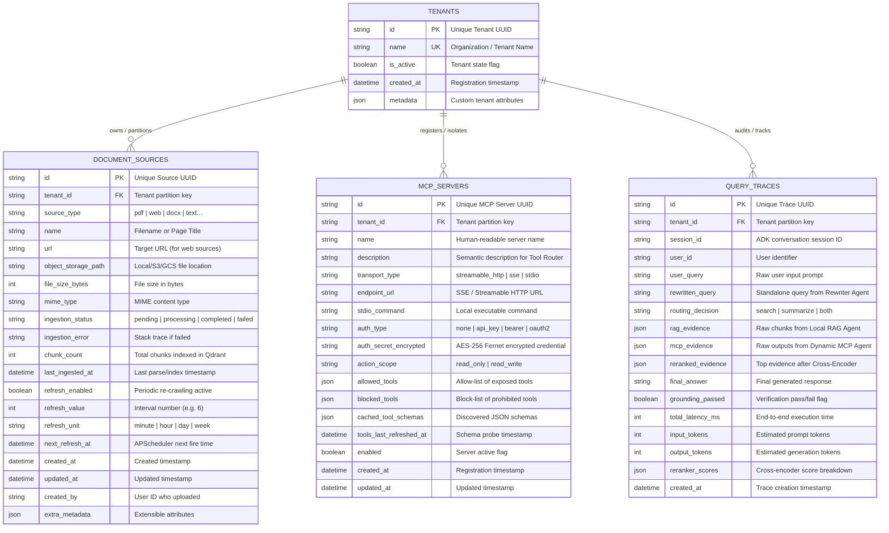

# Database Schema & Table Reference Guide

**Document:** `docs/database_schema_reference.md`  
**Target Audience:** Software Engineers, Backend Developers, and Data Architects  
**Source Models:** [`api/models.py`](file:///Users/rajendar/code/responsive_agent/api/models.py)  
**Database Engine:** PostgreSQL 16+ (via `asyncpg` async driver)  

---

## 1. High-Level Entity Relationship Diagram (ERD)

The database schema is designed around four primary functional domains: **Multi-Tenancy**, **Document Ingestion & Web Refresh**, **Dynamic MCP Tool Registry**, and **Query Observability / Audit Traces**.



---

## 2. Table-by-Table Detailed Reference

---

### Table 1: `tenants`

#### Purpose
Maintains organization and tenant boundaries. In **Single-Tenant Mode** (the default demo setup), a default record (`id="default"`) is automatically referenced. In **Multi-Tenant Mode**, this table provides isolation so different departments or clients cannot access each other's documents, MCP servers, or query history.

#### Columns
| Column Name | Data Type | Nullable | Default | Description & Developer Notes |
| :--- | :--- | :---: | :---: | :--- |
| `id` | `VARCHAR(64)` | No | `UUIDv4` | **Primary Key**. Unique string identifier for the tenant (e.g., `default` or `c1b84e3a-71a4-4f4c-81be-8e0c4a4a1a11`). |
| `name` | `VARCHAR(256)` | No | — | **Unique**. Human-readable tenant name (e.g., `Engineering Department`, `Acme Corp`). |
| `is_active` | `BOOLEAN` | No | `True` | Soft-delete / suspension toggle. If `False`, API requests for this tenant should be rejected by middleware. |
| `created_at` | `TIMESTAMP` | No | `now()` | UTC creation timestamp generated by the database server. |
| `metadata` | `JSON` | Yes | `NULL` | Flexible JSON payload for tenant-specific configuration (e.g., custom rate limits, allowed domains, feature flags). |

#### Indexes & Constraints
- `PRIMARY KEY (id)`
- `UNIQUE (name)`

---

### Table 2: `document_sources`

#### Purpose
The **system of record for all ingested knowledge**. Every PDF, Word document, or web URL registered by users has a row in this table. It tracks ingestion progress, chunk count in Qdrant, errors, and scheduled freshness configuration.

#### Columns
| Column Name | Data Type | Nullable | Default | Description & Developer Notes |
| :--- | :--- | :---: | :---: | :--- |
| `id` | `VARCHAR(64)` | No | `UUIDv4` | **Primary Key**. Source identifier. Used as the foreign key tag `source_id` in Qdrant vector payloads. |
| `tenant_id` | `VARCHAR(64)` | No | — | **Partition Key**. Foreign identifier tying this source to a tenant. Indexed for fast lookup. |
| `source_type` | `VARCHAR(32)` | No | — | Format type. Values: `pdf`, `web`, `docx`, `pptx`, `xlsx`, `csv`, `markdown`, `html`. |
| `name` | `VARCHAR(512)` | No | — | Display name. Original filename (e.g. `Architecture.pdf`) or web page title. Used in answer citations! |
| `url` | `TEXT` | Yes | `NULL` | The fully qualified target URL for web sources (e.g., `https://docs.example.com/api`). Null for uploaded files. |
| `object_storage_path` | `TEXT` | Yes | `NULL` | Physical storage location of uploaded files (e.g., `uploads/abc-123_report.pdf` or an S3/GCS URI). Null for web URLs. |
| `file_size_bytes` | `INTEGER` | Yes | `NULL` | File size in bytes for storage tracking and audit quotas. |
| `mime_type` | `VARCHAR(128)` | Yes | `NULL` | Detected MIME content type (e.g., `application/pdf`, `text/html`). Used by `ParserRouter`. |
| `ingestion_status` | `VARCHAR(32)` | No | `'pending'` | Ingestion lifecycle state: `'pending'`, `'processing'`, `'completed'`, `'failed'`. |
| `ingestion_error` | `TEXT` | Yes | `NULL` | Stores the error message or traceback if `ingestion_status == 'failed'`. Displayed in Admin/UI for debugging. |
| `chunk_count` | `INTEGER` | No | `0` | Total number of chunks generated from this document and actively stored in Qdrant. |
| `last_ingested_at`| `TIMESTAMP` | Yes | `NULL` | Timestamp of the most recent successful parsing, chunking, and vector indexing run. |
| `refresh_enabled` | `BOOLEAN` | No | `False` | **Web Freshness Toggle**. If `True`, APScheduler periodically re-crawls and re-indexes this source. |
| `refresh_value` | `INTEGER` | Yes | `NULL` | Interval multiplier (e.g., `15` for every 15 minutes, `24` for every 24 hours). |
| `refresh_unit` | `VARCHAR(16)` | Yes | `NULL` | Interval time unit. Enum: `'minute'`, `'hour'`, `'day'`, `'week'`. |
| `next_refresh_at` | `TIMESTAMP` | Yes | `NULL` | The exact calculated next execution time computed by APScheduler. Displayed in UI status tables. |
| `created_at` | `TIMESTAMP` | No | `now()` | Record creation timestamp. |
| `updated_at` | `TIMESTAMP` | No | `now()` | Automatically updated on every row modification (`onupdate=func.now()`). |
| `created_by` | `VARCHAR(256)` | Yes | `NULL` | Identifier of the user or API client who registered the source. |
| `extra_metadata` | `JSON` | Yes | `NULL` | Arbitrary key-value metadata (e.g. document tags, authors, version number, classification level). |

#### Indexes & Constraints
- `PRIMARY KEY (id)`
- `INDEX ix_doc_sources_tenant (tenant_id)` — Accelerates tenant-scoped source filtering.
- `INDEX ix_doc_sources_status (ingestion_status)` — Accelerates worker queries polling for `pending` jobs.

---

### Table 3: `mcp_servers`

#### Purpose
Stores registered **Model Context Protocol (MCP)** servers. The platform dynamically queries this table at runtime to construct Google ADK `MCPToolset` instances. Credentials are encrypted at rest using AES-256 (Fernet).

#### Columns
| Column Name | Data Type | Nullable | Default | Description & Developer Notes |
| :--- | :--- | :---: | :---: | :--- |
| `id` | `VARCHAR(64)` | No | `UUIDv4` | **Primary Key**. Unique identifier for the registered MCP server. |
| `tenant_id` | `VARCHAR(64)` | No | — | Tenant identifier. Prevents Tenant A from using or seeing Tenant B's MCP servers. |
| `name` | `VARCHAR(256)` | No | — | Unique name per tenant (e.g. `github-mcp`, `jira-server`, `slack-mcp`). |
| `description` | `TEXT` | No | `""` | Semantic description of the server's capabilities. **Used by MCP Tool Router** to select relevant tools! |
| `transport_type` | `VARCHAR(32)` | No | `'streamable_http'` | Protocol transport: `'streamable_http'`, `'sse'`, or `'stdio'`. |
| `endpoint_url` | `TEXT` | Yes | `NULL` | Network endpoint URL for HTTP/SSE transports (e.g., `https://mcp.internal.net/sse`). |
| `stdio_command` | `TEXT` | Yes | `NULL` | Command string for local process execution (e.g., `npx -y @modelcontextprotocol/server-postgres`). |
| `auth_type` | `VARCHAR(32)` | No | `'none'` | Authentication mechanism: `'none'`, `'api_key'`, `'bearer'`, `'oauth2'`. |
| `auth_secret_encrypted` | `TEXT` | Yes | `NULL` | **Security Sensitive**. AES-256 (Fernet) ciphertext containing API keys or OAuth access tokens. Decrypted only in memory. |
| `action_scope` | `VARCHAR(32)` | No | `'read_only'` | **Granular Tool Scope Policy**. Supports compound scopes (e.g. `'read_only'`, `'read,create'`, `'read,update'`, `'read,create,update'`, `'read_write'`). Automatically classifies tools by verb taxonomy (READ / CREATE / UPDATE / DELETE) and filters dynamically. |
| `allowed_tools` | `JSON` | Yes | `NULL` | Optional allow-list array `["search_issues", "get_file"]`. If `NULL`, all discovered tools are permitted. |
| `blocked_tools` | `JSON` | Yes | `NULL` | Block-list array of prohibited tool names `["delete_repo", "drop_table"]`. |
| `cached_tool_schemas` | `JSON` | Yes | `NULL` | Cached array of JSON schemas returned by MCP `tools/list` on registration/test. Prevents latency on every query. |
| `tools_last_refreshed_at`| `TIMESTAMP` | Yes | `NULL` | Timestamp when the MCP tool schemas were last probed and refreshed. |
| `enabled` | `BOOLEAN` | No | `True` | Active status toggle. Set to `False` to temporarily deactivate an MCP server without deleting configuration. |
| `created_at` | `TIMESTAMP` | No | `now()` | Registration timestamp. |
| `updated_at` | `TIMESTAMP` | No | `now()` | Updated timestamp. |

#### Indexes & Constraints
- `PRIMARY KEY (id)`
- `UNIQUE CONSTRAINT uq_mcp_tenant_name (tenant_id, name)` — Prevents duplicate server names within the same tenant.
- `INDEX ix_mcp_servers_tenant_enabled (tenant_id, enabled)` — Fast lookup for active servers during chat query execution.

---

### Table 4: `query_traces`

#### Purpose
The **observability and auditing ledger**. Every user interaction handled by the Root Orchestrator can be logged here. It captures the user's prompt, query rewriting, evidence gathered by both RAG and MCP agents, reranker scores, tokens consumed, latency, and grounding verification outcomes.

#### Columns
| Column Name | Data Type | Nullable | Default | Description & Developer Notes |
| :--- | :--- | :---: | :---: | :--- |
| `id` | `VARCHAR(64)` | No | `UUIDv4` | **Primary Key**. Trace record identifier. |
| `tenant_id` | `VARCHAR(64)` | No | — | Tenant identifier for multi-tenant analytics and billing. |
| `session_id` | `VARCHAR(64)` | No | — | Google ADK session identifier tying multi-turn conversation steps together. |
| `user_id` | `VARCHAR(256)` | Yes | `NULL` | User identity string (e.g. email, user UUID, or `'anonymous'`). |
| `user_query` | `TEXT` | No | — | The exact raw question asked by the user. |
| `rewritten_query` | `TEXT` | Yes | `NULL` | The decontextualized standalone query generated by `QueryRewriterAgent`. |
| `routing_decision`| `VARCHAR(64)` | Yes | `NULL` | Orchestrator plan decision: `'search'`, `'summarize'`, or `'both'`. |
| `rag_evidence` | `JSON` | Yes | `NULL` | Array of candidate chunks retrieved by `LocalRAGAgent` from Qdrant. |
| `mcp_evidence` | `JSON` | Yes | `NULL` | Array of tool call outputs returned by `DynamicMCPAgent`. |
| `reranked_evidence`| `JSON` | Yes | `NULL` | The top-K filtered evidence snippets produced by `CrossEncoderReranker`. |
| `final_answer` | `TEXT` | Yes | `NULL` | The final cited markdown response presented to the user. |
| `grounding_passed`| `BOOLEAN` | Yes | `NULL` | Grounding check result: `True` if `VerifierAgent` confirmed all claims cite evidence, `False` if ungrounded. |
| `total_latency_ms`| `INTEGER` | Yes | `NULL` | Total round-trip time in milliseconds from request to final token. |
| `input_tokens` | `INTEGER` | Yes | `NULL` | Total prompt/context tokens consumed across all agent LLM calls. |
| `output_tokens` | `INTEGER` | Yes | `NULL` | Total completion tokens generated across all agent LLM calls. |
| `reranker_scores` | `JSON` | Yes | `NULL` | Cross-encoder relevance scores per candidate item (`{chunk_id: score}`). |
| `created_at` | `TIMESTAMP` | No | `now()` | Timestamp of query execution. |

#### Indexes & Constraints
- `PRIMARY KEY (id)`
- `INDEX ix_traces_tenant_created (tenant_id, created_at)` — Enables fast time-series queries for admin dashboards and audit reports.

---

## 3. Short-Term Memory (STM) Tables (Google ADK)

In addition to our custom tables above, Google ADK's `DatabaseSessionService` ([`memory/memory.py`](file:///Users/rajendar/code/responsive_agent/memory/memory.py#L21-L47)) creates and manages its own internal tables in the same PostgreSQL database:

| ADK Table | Purpose |
| :--- | :--- |
| `adk_sessions` | Stores conversation sessions, mapped by `app_name`, `user_id`, and `session_id`. Holds the `state` JSON dictionary (used as the shared scratchpad for `rag_evidence`, `mcp_evidence`, and `reranked_evidence`). |
| `adk_events` | Stores individual message history and event logs (user questions, agent intermediate tool calls, final answers) enabling multi-turn context. |

---

## 4. Developer Cheat Sheet: Common Queries (SQLAlchemy 2.0 Async)

### How to insert a new document source
```python
from api.models import DocumentSource, SourceType, IngestionStatus

new_doc = DocumentSource(
    tenant_id="default",
    source_type=SourceType.PDF,
    name="System_Architecture.pdf",
    object_storage_path="uploads/System_Architecture.pdf",
    file_size_bytes=1048576,
    mime_type="application/pdf",
    ingestion_status=IngestionStatus.PENDING,
)
session.add(new_doc)
await session.commit()
```

### How to update ingestion status & chunk count
```python
from sqlalchemy import select
from api.models import DocumentSource, IngestionStatus
from datetime import datetime

result = await session.execute(
    select(DocumentSource).where(DocumentSource.id == source_id)
)
source = result.scalar_one_or_none()

if source:
    source.ingestion_status = IngestionStatus.COMPLETED
    source.chunk_count = 42
    source.last_ingested_at = datetime.utcnow()
    await session.commit()
```

### How to query all active MCP servers for a tenant
```python
from sqlalchemy import select
from api.models import MCPServer

stmt = (
    select(MCPServer)
    .where(
        MCPServer.tenant_id == "default",
        MCPServer.enabled == True,
    )
    .order_by(MCPServer.name.asc())
)
result = await session.execute(stmt)
servers: list[MCPServer] = result.scalars().all()
```

### How to query failed sources for monitoring
```python
from sqlalchemy import select
from api.models import DocumentSource, IngestionStatus

stmt = (
    select(DocumentSource)
    .where(DocumentSource.ingestion_status == IngestionStatus.FAILED)
    .order_by(DocumentSource.updated_at.desc())
)
result = await session.execute(stmt)
failed_sources = result.scalars().all()
for s in failed_sources:
    print(f"Source {s.name} failed with error: {s.ingestion_error}")
```
